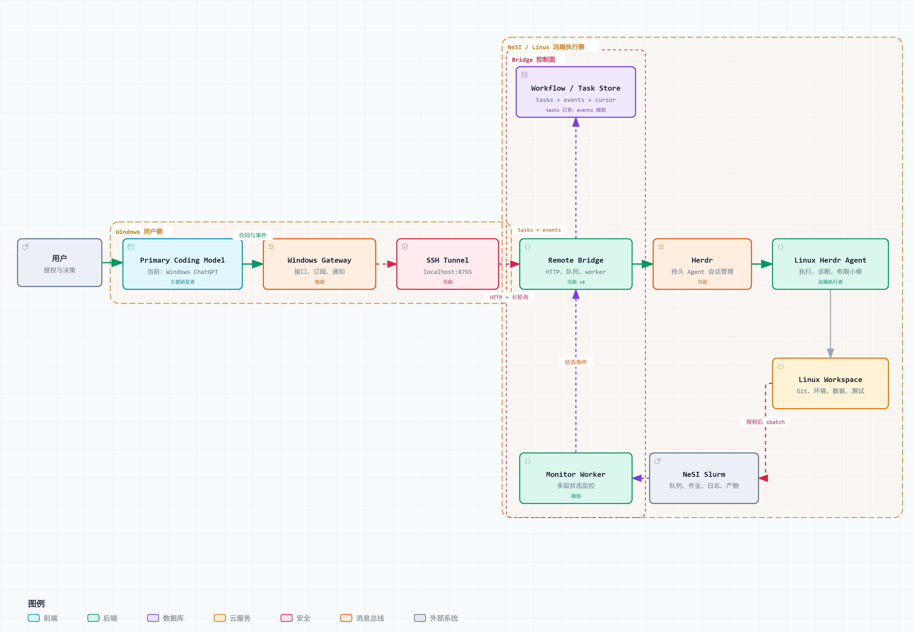
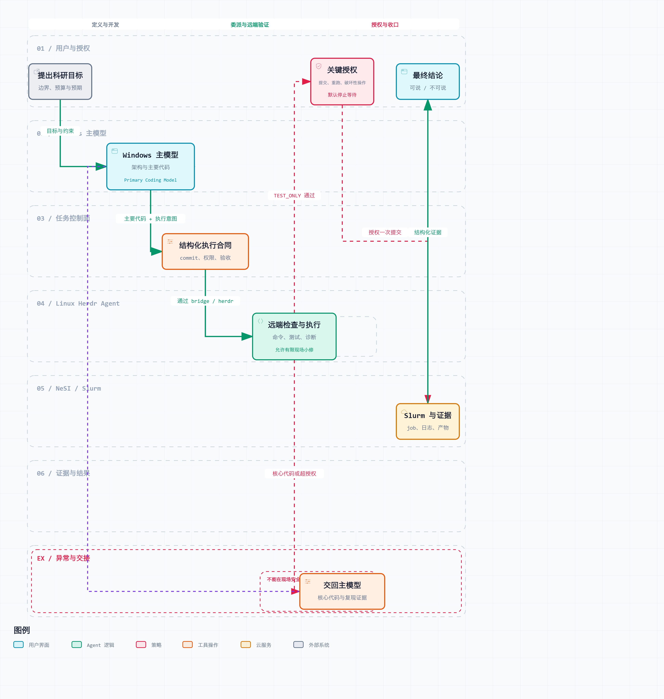

<div align="center">
  
</div>

# Herdr Task Bridge

[](https://github.com/Jiaofeisiling/herdr-task-bridge/actions/workflows/tests.yml)
[](LICENSE)

English | [简体中文](README.zh-CN.md)

`herdr-task-bridge` is an execution gateway for remote research computing. It lets you work entirely in ChatGPT, Claude, Cursor, or another AI development tool on Windows while the commands, verification, and Slurm work that need a Linux/NeSI environment are carried out by a persistent Herdr agent — without logging into the server for routine operations yourself.

v4 provides the Windows CLI, the HTTP bridge behind an SSH tunnel, the SQLite asynchronous task queue with task dependencies, multi-agent routing, mutual exclusion, and conservative recovery. The "Target architecture" below also covers the Windows Gateway, active notification, and dedicated monitoring worker that are **not yet implemented** (the bridge's half of the event stream, which they would consume, is); this document distinguishes what exists from what is planned.

## What this project is

This is not a thin wrapper around a remote shell, and not two AIs chatting freely. It connects roles with distinct, complementary responsibilities:

- **Windows primary coding model** — the main model you choose; typically ChatGPT on Windows today. It understands the research goal and owns architecture, algorithms, most of the code, cross-file refactoring, review, and PRs.
- **Linux Herdr agent (remote execution engineer)** — runs commands in the real Linux/NeSI environment, diagnoses environment problems, runs tests and minimal fixes, submits or monitors Slurm work within its authorisation, and returns structured evidence. It is not the default primary code author.
- **You (owner / approver)** — define goals, budget, and permission boundaries, choose the primary model, and make the final call on anything expensive, destructive, irreversible, or scientifically ambiguous.
- **Bridge / gateway (control plane)** — reliably delivers execution contracts, persists tasks and events, recovers connections, deduplicates, routes, and notifies. It makes neither the research decisions nor the Linux execution.

A workflow has exactly one primary coding model at a time. ChatGPT, Claude, and Cursor can each serve as the entry point or adapter, but they must not modify the same workspace concurrently without an explicit handover and branch isolation.

### Code ownership boundary

The Linux Herdr agent may independently write what genuinely belongs in the Linux environment: Bash/Slurm scripts, module/conda/CUDA environment glue, diagnostic scripts, and the minimal local fixes needed to get something passing in the real environment. The following stays with the Windows primary model by default: core algorithms, model architecture, data splits, evaluation protocol, public APIs, cross-module refactoring, and most business code.

Every execution contract should choose one coding policy:

| Mode | What the Linux Herdr agent may change |
|---|---|
| `no_code_changes` | Read-only inspection and execution; no code modification. |
| `environment_and_minimal_fix` | Default. Linux-specific glue plus the minimal fixes needed for verification. |
| `scoped_development` | A bounded piece of development within named files, branches, and acceptance criteria. |

Whichever mode applies, the single-writer rule holds: the Windows primary model and the Linux Herdr agent never edit the same file at the same time. Genuine parallel work uses separate Git branches or worktrees and hands over through commits/PRs.

## Target architecture

[](docs/diagrams/research-execution-architecture.html)

> Click the image for an interactive diagram with zoom, theme switching, and export.

The target architecture separates the control plane from the execution plane: the primary model produces execution contracts, the gateway/bridge handles reliable delivery and state, the Herdr agent executes in the real environment, and a monitor worker independently tracks long-running jobs. Monitoring should not occupy an execution agent for long stretches.

## End-to-end research workflow

[](docs/diagrams/research-execution-workflow.html)

> Click the image for an interactive diagram with zoom, theme switching, and export.

An execution contract should carry at least:

```yaml
objective: the research or engineering goal
project: project identifier
workdir: an explicit working directory on Linux
expected_git_commit: the expected baseline commit
allowed_actions: which reads, modifications, installs, submissions or cancellations are permitted
coding_policy: no_code_changes | environment_and_minimal_fix | scoped_development
slurm_policy: dry-run only, TEST_ONLY permitted, or a single authorised real submission
acceptance: machine-checkable acceptance conditions
reporting: which logs, artifacts, metrics, limitations and evidence to return
```

## Status and evidence boundaries

These layers must be reported separately. A single `done` must never stand in for all of them:

1. Whether the bridge service is reachable.
2. Whether the Herdr agent is `idle`, `working`, `done`, or in an error state.
3. Whether the bridge `task_id` is `queued`, `running`, `done`, `error`, or `orphaned`.
4. Whether the Slurm `job_id` is queued, running, completed, failed, or cancelled.
5. Whether logs, checkpoints, tables, and other artifacts exist and are complete.
6. Whether the metrics, sample counts, configuration, and evaluation protocol actually support a research conclusion.

Therefore: **a bridge task reaching `done` does not mean the Slurm job finished, and Slurm reporting `COMPLETED` does not mean the research result is valid.** `orphaned` only means the bridge lost reliable tracking; the remote action may still be running. Inspect the real effects before doing anything else, and never blindly retry.

Active reporting should use a durable event stream rather than having the Windows side poll a wall of terminal text. The remote side now writes `task_events` transactionally (see [Event stream](#event-stream)); the intended design has a Windows gateway consume them with a cursor-based long poll or subscription: silent while nothing changes, and notifying on `needs_input`, `error`, `orphaned`, completion, or a new artifact. The correlation identifiers are:

```text
workflow_id → task_id → command_run_id → slurm_job_id → artifact_id
                                      ↘ event_seq
```

## When "main development" can be called complete

Not yet. Below is the acceptance checklist from v4 to that point. Only once every blocking item is done **and** verified end to end against a real NeSI environment does this move into a maintenance-and-extension phase.

### Already in place

- [x] Windows PowerShell CLI and HTTP bridge.
- [x] Persistent SQLite tasks, asynchronous delegation, conservative `orphaned` marking after a restart.
- [x] Multi-agent discovery, explicit routing, and per-agent mutual exclusion.
- [x] Synchronous/asynchronous execution, queue depth limits, timeouts, and basic token authentication.
- [x] Bridge supervisor, deployment aliases, and a pytest/Pester/CI baseline.
- [x] Documentation of roles, code ownership, target architecture, workflow, and evidence boundaries.
- [x] **Reliable result extraction** — agents deliver results through a per-task file rather than scraped terminal text, so a backend's terminal rendering (Claude Code vs OpenCode) no longer determines whether a result can be read at all.
- [x] **Structured results** — an agent may write its result as a JSON object (`status`, `summary`, `job_ids`, `artifacts`, `metrics`, `warnings`, `changed_files`) and callers read the fields from `result_data`; plain text is still accepted unchanged. See [Structured results](#structured-results).
- [x] **A single task state machine** — one transition table and one code path that writes a status, so two paths racing to finish a task cannot both win. See [State machine](#state-machine).
- [x] **Workflows** — `workflow_id`, `depends_on`, cancellation of queued tasks, and cancellation of everything downstream of a failure. See [Workflows and dependencies](#workflows-and-dependencies).
- [x] **Opt-in re-pointing** of a queued task whose agent no longer exists (`reroute: any`); the default still fails it unsent.

### Blocking items for main development

- [ ] **Workflow and execution contracts** — `workflow_id`, task dependencies and idempotency keys exist; still missing are an execution-contract schema, originating client, permission/coding policy, and correlation IDs.
- [x] **Durable event stream** — every status change is written as a `task_events` row in the transaction that makes it, with a monotonic `seq`, read through `GET /events` with a cursor and a long poll. See [Event stream](#event-stream). What consumes it and notifies — the Gateway and active-notification items below — is not built.
- [ ] **Windows Gateway** — lift the shared client, SSH tunnel lifecycle, reconnection, subscriptions, and ChatGPT/Claude/Cursor adapters out of a single-shot CLI.
- [ ] **Active notification** — notify only on completion, failure, an authorisation request, `orphaned`, or important new evidence; deduplicate, stay quiet while nothing changes, and stop automatically at a terminal state.
- [ ] **Independent monitoring worker** — track bridge tasks, Herdr agents, Slurm jobs, and artifacts separately without occupying an execution agent.
- [x] **Slurm safety gate** — a per-task policy (`submit` / `test_only` / `dry_run_only`) stated in the prompt and recorded against the task, job IDs requested in every result, and no automatic resubmission from an unknown state. Declared rather than enforced: the bridge is not in the execution path and cannot block an `sbatch`.
- [ ] **Structured remote reporting** — the final report is structured (artifacts, metrics, warnings, job IDs) and progress travels a file channel; still missing are a `needs_input` state and live progress events.
- [ ] **Controlled concurrency and write isolation** — execute asynchronous tasks concurrently per agent, with single-writer or branch/worktree isolation and explicit handover for writes to the same project.
- [ ] **Secure defaults** — done: the bridge refuses to start without a token, a token script, private files, request limits and an audit trail (see [Configuration and security](#configuration-and-security)). Not possible: command and directory allowlists and per-task permissions, because the bridge sends text to an agent and the agent decides what to run.
- [ ] **Reproducible evidence bundle** — a final report that always carries the commit, workdir, commands, environment, job/task IDs, log and artifact paths, metric configuration, sample counts, and what may and may not be claimed.
- [ ] **Real end-to-end acceptance** — covering normal execution, bridge restart, tunnel interruption, duplicate requests, timeout/`orphaned`, authorisation pauses, Slurm success and failure, and notification recovery.
- [ ] **Release readiness** — install/upgrade/uninstall documentation, compatibility notes, migration scripts, and a stable release/tag verified on real NeSI.

### Extensions that do not block main development

- Web dashboard, mobile notifications, and further UI.
- Schedulers beyond Slurm, or cloud compute backends.
- Large file transfer, online artifact preview, and integration with long-term experiment tracking platforms.
- More primary-model adapters and cross-host federated scheduling.

## Current v4 implementation


```
Windows PowerShell client (sentinel.ps1)
        │ HTTP over a private connection or SSH port forward
        ▼
bridge.py on a Linux host (ThreadingHTTPServer + SQLite)
        │ herdr CLI
        ▼
Persistent Herdr-managed agent session(s)
```

The service has two execution modes:

- **Synchronous** — `/ask` and `/prompt` hold the selected agent's lock and keep the request open until the agent finishes.
- **Asynchronous** — `/delegate` stores a task in SQLite and returns a `task_id` immediately. A background worker executes queued tasks and exposes their state through `/tasks/<id>`.

Locks are **per agent**, so work directed to different agents is isolated. The asynchronous worker itself is intentionally single-threaded; this release does not promise parallel execution of queued tasks across agents. `/health` is independent of Herdr and SQLite, so it answers whether the bridge process is alive even when agents or tasks are busy.

## Quick start

This example assumes that a private connection from Windows to the remote bridge already exists (for example, a VS Code Remote-SSH local port forward to `127.0.0.1:8765`). Run it from the repository root:

```powershell
.\sentinel.ps1 health
.\sentinel.ps1 ready

$id = (.\sentinel.ps1 delegate "summarize the current directory; do not modify files" | ConvertFrom-Json).task_id
.\sentinel.ps1 wait $id
```

If the host has more than one Herdr agent, inspect them and select one explicitly:

```powershell
.\sentinel.ps1 agents
.\sentinel.ps1 ask -Agent "your-agent-name" "check disk usage"
```

## Command reference

| Command | HTTP | Endpoint | Purpose |
|---|---|---|---|
| `health` | GET | `/health` | Process liveness only; does not contact Herdr or SQLite. |
| `agents` | GET | `/agents` | Lists Herdr-managed agents and their status. |
| `ready` | GET | `/ready` | Reports whether the selected agent can accept work (`idle` or `done`). |
| `status` | GET | `/status` | Returns the raw `herdr agent get` response. |
| `read` | GET | `/read` | Reads recent agent-terminal lines for diagnosis. `source` is `recent-unwrapped` (the default, honours `lines`) or `visible` (the screen). For an agent that is working, an unnamed source falls back to `visible` and the response says so in `note`. |
| `quota` | GET | `/quota` | Lists agents temporarily blocked after a provider quota or balance failure. |
| `quota-reset` | POST | `/quota/reset` | Clears one agent's quota circuit with `-Agent`, or all circuits when deliberately called without it. |
| `delegate <task>` | POST | `/delegate` | Queues a task and returns a `task_id`; default server timeout is six hours. Optional `-WorkflowId`, `-DependsOn <id,id>` and `-Reroute none\|any` (see [Workflows and dependencies](#workflows-and-dependencies)). |
| `task <task_id>` | GET | `/tasks/<id>` | Task state, in-flight `progress`, `depends_on`, the structured `result_data` when there is one, and — while `queued` — a `queued_reason` explaining what it is waiting on. |
| `wait <task_id>` | GET | `/tasks/<id>` | Polls every three seconds until a terminal state, then prints the result or error. |
| `events [task_id]` | GET | `/events` | Status changes after a cursor (`-After <seq>`), optionally held open for up to 30 s (`-WaitSec`) until one happens; filter with a task id or `-WorkflowId`. See [Event stream](#event-stream). |
| `cancel <task_id>` | POST | `/tasks/<id>/cancel` | Cancels a task that is still `queued`; `409` for one that has started, since the bridge cannot stop an agent mid-task. |
| `workflow <workflow_id>` | GET | `/workflows/<id>` | Every task carrying that `workflow_id`, with per-status `counts` and an overall `state` (`in_progress`, `done`, `failed`, or `cancelled` when every task was cancelled on purpose). |
| `tasks` | GET | `/tasks` | Lists the 20 most recent tasks. `status` (`queued`, `running`, `done`, `error`, `orphaned`, `quota_exhausted`, `cancelled`) and `limit` (1–200) narrow or widen that — `tasks -Status queued` is how to find work that is waiting. |
| `ask <task>` | POST | `/ask` | Runs synchronously and returns the agent result; returns `409` if that agent is busy. |
| `prompt <task>` | POST | `/prompt` | Runs synchronously but does not extract a result. The text is wrapped in the delegation envelope, so it is a task, not a keystroke: `/compact` sent this way is not a slash command. With `-Agent` it goes to exactly that agent -- never to a fallback. |

Common client options are `-Agent <name>`, `-TimeoutMs <milliseconds>` (for `ask`, `prompt`, and `delegate`), `-Lines <count>` and `-Source recent-unwrapped|visible` (for `read`), and `-WorkflowId`, `-DependsOn` and `-Reroute` (for `delegate`). Agent names are trimmed, must be non-empty, and are limited to 200 characters. Request timeouts must be between 1 second and 6 hours.

### Exit codes and channel failures

| Code | Meaning |
|---|---|
| `0` | Success |
| `1` | The request failed, or a task ended in `error` |
| `2` | A task ended `orphaned` |
| `3` | A task ended `quota_exhausted` |
| `4` | **The bridge was never reached** — the channel is down, and nothing is known about the bridge itself |
| `5` | **The bridge answers `/health`, but this one request got no reply in time** — the channel is fine, do not reconnect anything |
| `6` | A task ended `cancelled` — stopped before it started, so nothing ran |

Code `4` is deliberately distinct. When the SSH forward is not in place, the bridge is usually running perfectly well on the remote side and simply cannot be talked to; reporting that as a bridge failure sends the reader to the wrong machine. The message names which of the two channel states applies — nothing listening, or connected but never replying — because they need different fixes, and says plainly that the bridge's state is unknown rather than bad.

Every quick command is bounded (5 s by default, `SENTINEL_CLIENT_TIMEOUT_SEC`). That bound exists because a caller typically gives a command 10–30 s before it hands back an empty result and reports it blocked; measured over 3,400 recorded calls, `health` took 1.9 s at the median and every empty result took exactly the caller's own wait. PowerShell 7's `Invoke-RestMethod` has **no timeout by default**, so a forward that still accepted connections but no longer reached the host used to hang the client indefinitely, and the explanation below could never arrive in time to be read. `ask` and `prompt` are bounded by the `-TimeoutMs` you gave them plus 30 s, so a legitimately slow one is not cut off.

**Retrying is not always safe, and the client says so.** A request that gets no reply may already have taken effect: the reply was lost, not necessarily the request. `delegate` therefore carries an idempotency key (generated if you do not pass one, printed if the reply is lost), and retrying with the same `-IdempotencyKey` returns the original task instead of queueing a second copy — which, with Slurm submission allowed by default, would otherwise be a duplicate job. The bridge claims the key atomically inside the enqueue transaction (a check-then-insert would lose the race under concurrent retries), serves a replay before anything that could refuse it (a full queue, an agent that has since gone), and answers `422` if a key is reused with different parameters rather than hand back a result for something you did not ask for. `ask` and `prompt` have no such key; on a lost reply they say the request may already have run and point at `ready`/`read`.

`wait` rides out transient failures: a single unanswered poll does not end it, and it gives up with exit `4` only after `SENTINEL_WAIT_TOLERANCE_SEC` (60 s) of continuous failure, telling you the task is untouched.

When a request times out, the client probes `/health` before saying anything, because a timeout looks identical whether the forward is dead or the bridge is up and one call behind it is stuck — and the two want opposite reactions. Answering is exit `5`; silence is exit `4`.

Connection failures previously printed a raw `Invoke-RestMethod` stack trace **and exited 0**, so a caller had nothing to act on and nothing to branch on.

Note that `pwsh -Command "& sentinel.ps1 ..."` collapses any non-zero code to `1`. Use `pwsh -File`, or append `; exit $LASTEXITCODE`, to get the exact code.

## Task lifecycle and results

```
queued → running → done
  ↓        ↓   ↑ (one result-file reminder)
  ↓   error / orphaned / quota_exhausted
  ↓
cancelled   (only from queued: never sent to an agent)
```

### State machine

Every status change goes through one function, `transition()`, which checks the move against a single table and is a compare-and-set: it only applies if the task is still in the state the caller expected. Two paths racing to finish the same task — a shutdown orphaning it while the worker is still waiting on the agent, say — cannot both win, and the loser changes nothing. A move the table does not allow raises, since that is a bug in the caller rather than a lost race.

| From | May move to |
|---|---|
| `queued` | `running`, `error` (abandoned unsent), `cancelled` |
| `running` | `queued` (every fallback busy), `done`, `error`, `orphaned`, `quota_exhausted` |
| `error`, `orphaned` | `done` — only when a result file turns up late |
| `done`, `quota_exhausted`, `cancelled` | — final |

A worker whose task is no longer `running` when its answer arrives does not complete it, and leaves the result file where the late-adoption path will find it.

### Structured results

An agent may write its result file as a JSON object instead of prose:

```json
{
  "status": "success | partial | failed | blocked",
  "summary": "what was done, what it concluded, whether anything stuck",
  "job_ids": ["12345678"],
  "artifacts": ["/scratch/run1/log.txt"],
  "metrics": {"val_loss": 0.42},
  "warnings": [],
  "changed_files": []
}
```

Only `summary` is required. A fenced ` ```json ` block is accepted. The bridge reads the fields out of the text it was given and serves them as `result_data` with `result_format: "json"`; `result_text` is always the original, so nothing that read it breaks. Prose gives `result_format: "text"` and `result_data: null`.

A result that looks like JSON but is not usable — cut off, a missing `summary`, a field of the wrong type — is kept as text with a note in `error_text` saying why. It does not fail the task: the work was delivered and only the format slipped.

`result_data.status` is what the **agent** says about the work; the task's own `status` says only whether the bridge delivered the result. A task can be `done` with `result_data.status: "failed"`, and one must never be read as the other.

### Workflows and dependencies

```powershell
$build = (.\sentinel.ps1 delegate -WorkflowId run-7 "build the environment" | ConvertFrom-Json).task_id
$train = (.\sentinel.ps1 delegate -WorkflowId run-7 -DependsOn $build "train the model" | ConvertFrom-Json).task_id
.\sentinel.ps1 workflow run-7
```

- A task with `depends_on` stays `queued` until **every** task it names is `done`. The worker passes over it and runs whatever else can run, so a waiting task never holds up an unrelated one. `queued_reason` names what it is waiting for.
- A task can only name tasks that already exist, so the graph cannot contain a cycle. An unknown id is refused with `422` (`reason: unknown_dependency`), as is one that has already failed (`reason: dependency_failed`). Up to 20 dependencies, repeats counted once.
- If something a task waits on ends `error`, `orphaned`, `quota_exhausted` or `cancelled`, the task is `cancelled` — and so is everything downstream of it. None of them was sent to an agent, so resubmitting is safe. `orphaned` cancels too, although a late result could still turn it `done`: running work on an unknown outcome is the thing to avoid, and a cancelled task costs only a resubmit.
- `cancel` stops a task that is still `queued`. A task that has started cannot be stopped by the bridge (`409`); the agent decides what it does.
- Waiting tasks count towards the queue limit.

### Event stream

`/tasks/<id>` says where a task is now, not that it moved, and a caller that looks away misses anything that came and went. Every status change — including a task being created — is also written to `task_events`, **in the same transaction as the change**: there is never a change without its event or an event without its change, and a move that loses a race or is refused writes nothing.

```powershell
.\sentinel.ps1 events                       # everything so far
.\sentinel.ps1 events -After 41 -WaitSec 20 # what came after seq 41; hold the request open up to 20 s
.\sentinel.ps1 events -WorkflowId run-7     # one workflow's changes
```

Each event is `{seq, task_id, workflow_id, at, from_status, to_status}`; `from_status` is `null` for creation. The reply carries `next`, the last `seq` it returned (or the `after` it was given when there was nothing). Keep it and ask for what follows: because `seq` only grows, resuming after a dropped connection neither misses nor repeats an event. `limit` is 1–500 (default 100); `wait` is 0–30 s and returns the moment something happens, and immediately if the bridge is shutting down.

Events are a record of status changes, not of agent output, and they start from when the table was created: tasks that finished before that have none. The table is not pruned.

### Re-pointing a task whose agent is gone

By default a task queued for an agent that no longer exists is failed unsent after `SENTINEL_STALE_TARGET_SEC`, never redirected: sending work to the wrong agent is worse than not sending it. A caller that does not care which agent runs it can say so with `reroute: "any"` (`-Reroute any`). After the same wait, and only when herdr answered and listed no such agent, the bridge points the task at the best live agent whose provider is not blocked, preferring one that can take work now. The task has not started, so nothing can run twice; `agent` shows where it went and `rerouted_from` where it was meant to go. With no eligible agent it is failed as before.

- `orphaned` means the bridge lost the completion signal, not that the remote task necessarily failed. Do **not** blindly retry it; inspect the task's real effects first.
- `error` means the bridge confirmed an execution or result-collection failure.
- **`orphaned` and `error` are not always final.** If the agent delivers its result file after the bridge stopped waiting, the task is adopted: it becomes `done`, `result_text` is filled in, `recovered_at` is set, and the original error text is kept with a note rather than rewritten. This happens at startup, and whenever the task is queried (`task`, `wait`, `tasks`). Measured on the live host before this existed: 189 delivered results sitting uncollected — 76 on tasks marked `error`, 2 on `orphaned`, and 111 on no task at all. None belonged to a `done` task, which is the point: normal collection deletes the file, so every one of those was an answer the agent gave and the bridge threw away.
- **herdr aborting its wait is not the prompt failing.** The bridge sends `herdr agent prompt --wait`, which delivers the prompt and then waits for the agent. herdr aborts that wait with `agent_blocked` when it sees the agent become `blocked` — and it does so for a transient `blocked` as readily as for a real one (measured: `blocked`, then `working` one second later). The bridge used to read the abort as a failed delivery, mark the task `error`, and tell the caller the agent "requires interactive input". On the live host, **69 of the 96 tasks that failed this way had in fact delivered a result.** The abort is now an observation, not a verdict: the bridge watches what the agent does next — a result file or `working` means carry on; `blocked` for `SENTINEL_BLOCKED_CONFIRM_SEC` (20 s) means it really is waiting on input, and only then is that said (`reason: blocked_confirmed`); idle with no sign of activity within `SENTINEL_NOT_STARTED_GRACE_SEC` (8 s) is reported as `reason: delivery_unknown`, explicitly not as blocked. herdr's own `timeout` code is now a 504 rather than a 500.
- **Reading a working agent.** herdr will not read the history of a working agent once more lines are asked for than the screen holds — measured: fine at the screen's height, `agent_not_idle` one line past it, while `visible` is never refused and is clamped to the screen. The default request is past any screen, so every read of a working agent failed: 33 times in one night, each followed by a retry with `--source visible`, which the client silently dropped. `/read` now takes `source`. When none is named and herdr refuses the history, the bridge falls back to the visible screen and says so (`source`, `note`); when one is named, the caller gets what it asked for plus a `hint`. Failure diagnostics use the same fallback, so a task that fails while its agent is busy, or stuck on a prompt, still carries evidence instead of "terminal read failed".
- **The client no longer swallows options it does not know.** `sentinel.ps1` collects every undeclared argument into its free-text parameter, so a mistyped or unsupported option on a command that takes no text was dropped while the caller believed it had been sent. Those commands now refuse unrecognised arguments (exit 1). `-Source` is a real option, and PowerShell reads `--source` as `-Source`, so herdr's own spelling — the one its error message recommends — works.
- **A task too large to deliver is refused up front.** herdr takes the prompt as one command-line argument, and Linux caps a single argument at 131072 bytes: measured on the host, 131000 is delivered and 131072 fails with `Errno 7`. The bridge checked nothing, so an oversized task was accepted and queued — the caller was told `queued` — and then failed in the worker with that bare errno; it had happened once for real. `/delegate`, `/ask` and `/prompt` now measure what is actually sent (envelope, result path and policy line included, in UTF-8 bytes — a Chinese character is three) against `SENTINEL_MAX_PROMPT_BYTES`, and answer 400 with `reason: task_too_large` and what to do instead: put the material in a file on the host and refer to it by path.
- **A task queued for an agent that no longer exists no longer waits forever.** herdr drops an agent's name when its process restarts. Two tasks queued for `sentinel-claude` and `sentinel-opencode` stayed `queued` for three weeks: the bridge knew nothing would pick them up (`queued_reason` said so) but never acted on it, so a caller would `wait` indefinitely, and the tasks held queue slots; `/tasks` shows only the newest twenty, so nobody saw them. After `SENTINEL_STALE_TARGET_SEC` (10 minutes), a queued task whose agent herdr no longer lists is failed with an error that says it was never sent and is safe to resubmit. It is not re-pointed at some other agent unless the caller opted in with `reroute: any` (see [above](#re-pointing-a-task-whose-agent-is-gone)): sending work to the wrong agent is worse than not sending it. It waits the full period first, because an agent that is restarting is briefly absent from the list; and it does nothing when herdr cannot be asked, or when the agent exists but is busy.
- **A killed `herdr agent prompt` is not a failed prompt.** `bridge-restart` hangs up the whole process group, including the call the worker is waiting on. That call ended with no output and was reported as "Herdr prompt command failed:" followed by nothing, marking the task `error` — which tells a caller that retrying is safe. Whether the prompt had landed was never known. A call that ends with no output at all is now a lost track (the task is `orphaned`: "may still be executing"), and `error` can no longer overwrite `orphaned`, whichever of the shutdown and the worker gets there second.
- **`/prompt` gets the same wait-abort handling as a task** (v23 fixed only tasks): a transient `blocked` no longer produces a 500 saying the agent "requires interactive input".
- **A synchronous `ask` that times out (504) or finds no result after the reminder (502) now leaves a task row behind**, and says so in a `hint`. Before, the `task_id` in that response returned 404, so a result that arrived a minute later had nowhere to go — the 111 above. Successful asks and refused ones (busy, unavailable, quota) write nothing: the first needs no record and in the second nothing ran, so the success path is unchanged.
- `quota_exhausted` means every eligible fallback was also quota-blocked or reported a quota/balance failure. The task was not retried after that result.
- On restart, a task that was `running` becomes `orphaned`. The bridge never reruns it automatically.

While a task runs, `GET /tasks/<id>` also carries a `progress` field, and `wait` prints each new line as it appears. An agent may append to a per-task progress file — a job ID it just got, which step it is on, where it is stuck — using the same channel as the result. It is **optional**: an agent that reports nothing has done nothing wrong, and progress is a convenience for the operator rather than a second contract that can fail a task. The file is removed when the task reaches a terminal state, and the startup sweep collects any left by a task that was killed mid-flight.

Progress travels the file channel rather than the terminal on purpose. Terminal reads truncate, carry TUI chrome, and were measured showing an autocomplete suggestion that a caller read as live work.

Agents return results by writing one file per task under `SENTINEL_RESULT_DIR`; the bridge reads and removes the file. This avoids terminal scraping, truncation, UI noise, and coupling to an agent's terminal format. If the file is missing after an agent finishes, the bridge sends one narrowly scoped reminder to write the result file only. A second failure is reported as `error` with terminal output retained for diagnosis.

The result directory must be writable by both the bridge process and the selected agent. Put it **under the agents' own working directory** (`herdr agent list`, or `GET /agents`, reports each agent's `cwd`). The default falls in the system temp directory, outside that `cwd`, where an agent's permission system — OpenCode's `external_directory` rules, Claude Code's auto-mode classifier — sees an external write and can stall the task after the work is already done. Inside the `cwd` it is an ordinary in-project write. Never weaken an agent's general approval policy merely to collect results; move the directory instead.

### Driving the bridge from an AI session

[`docs/CLIENT_PROMPT.md`](docs/CLIENT_PROMPT.md) is a ready-made system prompt for the AI session on the calling side — endpoints, task states, when to use `/ask` versus `/delegate`, and the operational rules that are not discoverable from the API alone. It deliberately hard-codes no cluster configuration: partition names, QoS limits and quotas are the executing agent's job to determine at run time, not the client's to assert from a machine it cannot see.

### Slurm safety gate

Every delegated task carries a Slurm policy, stated in the prompt before the agent acts. Set it per request with `slurm_policy`, or change the deployment default with `SENTINEL_SLURM_POLICY`.

| Policy | The agent is told it may |
|---|---|
| `submit` *(default)* | Submit freely, at any scale. Do not resubmit repeatedly on failure — report it. Do not overwrite or delete existing checkpoints, results or datasets. |
| `test_only` | Debug/short-limit jobs only, not full scale. Same rules on resubmission and existing data. |
| `dry_run_only` | Static checks and `sbatch --test-only`. No real submission. |

Every policy asks for the job ID in the result, which is the part that makes a submission auditable and cancellable afterwards.

The default does not restrict submission. An earlier version withheld full-scale runs, which cost an extra round trip on every real job — a restriction chosen on an assumed risk rather than an observed one. Submitting is reversible: `scancel` it and resubmit, and the only cost is queue time. Not submitting is the expensive outcome. What is genuinely irreversible is not the submission but a job destroying work that already exists, so that is where every policy draws its line — along with not resubmitting on failure, which is how one bad script quietly burns an allocation.

**This is a declared policy, not an enforced one, and the difference matters.** The bridge is not in the execution path: it sends text through `herdr agent prompt`, and the agent decides what to run. Nothing here can see or block an `sbatch`. What the gate changes is that submitting production work becomes something the agent was *told* it may do rather than something it decided on its own, and that widening the policy is a deliberate act by the caller — present in the request and recorded against the task, so an audit can tell what the agent was permitted to do and not only what it did.

An unrecognised policy is rejected rather than quietly replaced by the default, because a typo in the strictest setting would otherwise become the loosest one the deployment allows. A task queued under one policy runs under that one, not under whatever the default happens to be when the worker reaches it.

The bridge never re-runs a task by itself. A task interrupted by a restart becomes `orphaned` and stays there, so an unknown Slurm state is never resolved by resubmitting.

### Active quota failover

The bridge recognises common provider signals such as Claude 5-hour/weekly usage limits, HTTP `429`, OpenCode API `402`, and insufficient API credit or balance. On detection it opens a durable circuit for the failed agent, skips the otherwise normal result-file reminder, and actively tries an eligible alternate agent.

With automatic discovery, an alternate must be a **different runtime family** (for example, Claude ↔ OpenCode) so the bridge does not simply move to another session that may share the same exhausted account. Set `SENTINEL_QUOTA_FAILOVER_AGENTS` to an ordered, explicit allowlist when your deployment has known independent fallback accounts. An unavailable fallback leaves asynchronous work queued for another attempt; only exhausted eligible fallbacks produce `quota_exhausted`.

After a provider's reset or an account recharge, verify the account outside the bridge and clear its circuit deliberately:

```powershell
sentinel quota
sentinel quota-reset -Agent "your-agent-name"
```

Do not clear a circuit merely because an agent is `idle`: provider limits can leave an agent idle while its account remains unavailable.

#### A refusal that is not quota

A provider can also refuse an agent because its **session has outgrown a per-request size limit** — for example OpenRouter's `Prompt tokens limit exceeded: 334110 > 185528`. From the bridge's side this looks exactly like success: herdr reports the agent `done`, as it does after any turn, and the refusal exists only as text in the agent's terminal. Before this was recognised, a task failed as "never wrote its result file — check permissions", a `prompt` returned `ok: true`, and `ready` kept saying the agent was ready.

It is now handled like a quota — a circuit, a failover — with differences that follow from the cure being different:

- The circuit is labelled `kind: context_limit` (a quota is `kind: quota`) in `/quota` and `/ready`, and `/ready` carries a `hint`: the session has to be compacted or restarted in its own terminal, and sending it more work fails the same way.
- It expires after `SENTINEL_CONTEXT_BLOCK_TTL_SECONDS` (default 10 minutes), not the quota's hour: the fix is a person acting, and a circuit that outlived it would keep a recovered agent out of service.
- A task that fails over is recorded as having run elsewhere: the row keeps the agent that was asked for, and a note says which one did the work.
- `/prompt` compares the agent's terminal from just before and just after the prompt. A refusal that is **new** is reported as `ok: false`, `reason: provider_rejected` (HTTP 502). An old error still on screen is not: it proves nothing about this prompt, and accusing a healthy agent opens a circuit on it. If the terminal cannot be read beforehand, nothing is claimed.
- A turn that ends within `SENTINEL_QUICK_END_SEC` (default 15 s) with no result file cannot have run the task. That is reported as `reason: ended_quickly` and says so, instead of pointing at permissions. This needs no knowledge of the provider's wording, so it also covers refusals the bridge has no pattern for. Only wording actually observed is matched; adding a guess would open a circuit on a healthy agent.

## Configuration and security

The remote service reads the following environment variables:

| Variable | Default | Meaning |
|---|---|---|
| `SENTINEL_BRIDGE_PORT` | `8765` | Listening port. |
| `HERDR_BIN` | `herdr` | Path to the Herdr executable. |
| `SENTINEL_AGENT` | unset (auto-select) | Pins the default target agent. Unset lets the bridge pick one that can take work. |
| `SENTINEL_DB` | `~/sentinel-bridge/tasks.db` | SQLite task-queue path. |
| `SENTINEL_RESULT_DIR` | System temp directory / `sentinel-bridge-results` | Shared directory for agent result files. |
| `SENTINEL_RESULT_RETENTION_DAYS` | `7` | Age at which the startup sweep deletes uncollected result files. `0` disables it. |
| `SENTINEL_BRIDGE_TOKEN` | **required** | Shared-secret authentication token, at least 16 characters. Without it the bridge refuses to start. Make one with `remote/bridge-set-token.sh`. |
| `SENTINEL_ALLOW_NO_AUTH` | unset | `1` lets the bridge start with no token. For a host nobody else can reach. |
| `SENTINEL_UMASK` | `077` | Octal umask for files the bridge creates. Relax it only if agents run as another user. |
| `SENTINEL_MAX_BODY_BYTES` | `1048576` | Largest request body; larger is refused with 413 unread. |
| `SENTINEL_REQUEST_TIMEOUT_SEC` | `30` | A connection that has not finished its request by then is dropped. |
| `SENTINEL_AUDIT_RETAIN_ROWS` | `50000` | Audit rows kept; the oldest are dropped. |
| `SENTINEL_CLIENT_NAME` | `sentinel.ps1` | Client-side: the label sent as `X-Sentinel-Client` for the audit trail. |
| `SENTINEL_MAX_QUEUE_DEPTH` | `50` | Maximum number of queued asynchronous tasks. |
| `SENTINEL_QUOTA_FAILOVER_AGENTS` | unset | Comma-separated, ordered fallback-agent allowlist after a quota failure. |
| `SENTINEL_SLURM_POLICY` | `submit` | Deployment default Slurm policy; a request's `slurm_policy` overrides it. |
| `SENTINEL_AGENT_PRIORITY` | unset | Ordered cost preference, cheapest first, matched on agent name or runtime family. Only orders agents that can take work now. |
| `SENTINEL_CLIENT_TIMEOUT_SEC` | `5` | Client-side (`sentinel.ps1`): upper bound on any quick call. Keep it comfortably under the time your caller waits before giving up. |
| `SENTINEL_WAIT_TOLERANCE_SEC` | `60` | Client-side: how long `wait` polls through a continuous channel outage before giving up with exit 4. |
| `SENTINEL_ASK_GRACE_SEC` | `30` | Client-side: slack added to an `ask`/`prompt`'s own `-TimeoutMs` before the client abandons it. |
| `SENTINEL_BLOCKED_CONFIRM_SEC` | `20` | After herdr aborts a wait with `agent_blocked`, how long the agent must *stay* blocked before the bridge reports it as genuinely blocked. |
| `SENTINEL_NOT_STARTED_GRACE_SEC` | `8` | After such an abort, how long to wait for any sign of activity before reporting that delivery is unknown. |
| `SENTINEL_SHUTDOWN_GRACE_SEC` | `5` | Bridge-side: how long an orderly shutdown waits for requests already in flight before giving up on them. |
| `SENTINEL_HERDR_TIMEOUT_SEC` | `30` | Bridge-side: bound on any herdr call that did not name its own. A hung herdr surfaces as a 504 instead of blocking a request thread indefinitely. |
| `SENTINEL_CONTEXT_BLOCK_TTL_SECONDS` | `600` | How long a circuit opened by a session-size refusal stays open. Shorter than the quota's, because the cure is someone compacting or restarting the session. |
| `SENTINEL_MAX_PROMPT_BYTES` | `120000` | The largest delegation prompt (envelope included, in UTF-8 bytes) the bridge accepts. Linux caps one command-line argument at 131072 bytes, and herdr takes the prompt as one. |
| `SENTINEL_STALE_TARGET_SEC` | `600` | How long a queued task may wait for an agent herdr no longer lists before it is failed as never sent. |
| `SENTINEL_QUICK_END_SEC` | `15` | A turn that ends sooner than this with no result file is reported as `ended_quickly`: too fast to have run the task. |
| `SENTINEL_QUOTA_BLOCK_TTL_SECONDS` | `3600` | How long a quota circuit stays open before expiring by itself. `0` keeps it open until cleared by hand. |

Copy [`remote/bridge.env.example`](remote/bridge.env.example) to the untracked `remote/bridge.env` for deployment-specific values. Never commit real hostnames, project identifiers, paths, usernames, prompts, or tokens; see [CONTRIBUTING.md](CONTRIBUTING.md) for the project's sensitive-data rules.

Loopback is not private on a shared login node: every user of the machine can reach the port and, through the bridge, have the agents run commands as you. So **the bridge does not start without a token**, or with one shorter than 16 characters, and says why (exit 2). To make one, run this in your own terminal on the host and give the value it prints once to each client as `SENTINEL_BRIDGE_TOKEN`:

```bash
bash remote/bridge-set-token.sh           # writes remote/bridge.env (mode 600), prints the token once
bash remote/bridge-restart.sh
```

`bridge-restart` first asks the new bridge whether it would accept its settings (`bridge.py --check`) and stops nothing if not, so adding this protection cannot take down the bridge that is running. `--rotate` replaces a token in use; every client must then be updated. `/health` answers without the token so a probe can tell the process is alive; everything else, including `/events`, `/workflows` and `/audit`, needs it.

What else is done, and why it is not left to the token alone:

- **Files are private.** `tasks.db` holds every task and result in the clear, and a default umask leaves it readable by every other user on the node. The bridge runs with a private umask, tightens an existing database file to mode 600, and warns, with the command to run, if its database directory or `SENTINEL_RESULT_DIR` is open to others (it does not change a directory it did not create). The supervisor makes `bridge.log` and `bridge.env` mode 600.
- **Requests are bounded.** A body over `SENTINEL_MAX_BODY_BYTES` is refused with 413 without being read, and a connection that stalls is dropped, so a local user cannot exhaust the bridge's memory or threads.
- **There is an audit trail.** Every request that is not a read, and every refusal of the token, is written before the reply is sent; read it with `GET /audit?after=<seq>&limit=`. It stores no token, query string or request body. With one shared token it cannot say who: the `X-Sentinel-Client` label is only a label.

None of this makes the bridge a sandbox. It sends text to an agent and the agent decides what to run, so it cannot allow-list commands or directories, and `slurm_policy` states what the agent was told rather than blocking anything. Whoever holds the token can do what the agents can: treat it like a password, and rotate it if it may have been seen.

## Reference deployment: NeSI

The maintained deployment uses a Git clone on a Linux host reachable from NeSI, a `screen` session, and the restart loop in [`remote/bridge-supervisor.sh`](remote/bridge-supervisor.sh). The helper functions in [`remote/bridge-aliases.sh`](remote/bridge-aliases.sh) are the authoritative implementation of the reference update flow:

```bash
echo 'source ~/herdr-task-bridge/remote/bridge-aliases.sh' >> ~/.bashrc
source ~/.bashrc

bridge-deploy    # pull and restart
bridge-status    # inspect screen, process, health, and logs
```

`bridge-restart` is a thin wrapper around [`remote/bridge-restart.sh`](remote/bridge-restart.sh), which is where the sequence lives. It is a script rather than a shell function because it must not depend on the shell it runs in: it finds its checkout from its own location, so it works from a child shell — which is how an agent runs it, and where the plain variable the function used to rely on does not exist. In order, it **checks that a new bridge can be started before stopping the old one** (the only step that cannot be undone, and the bridge is the way back in), restarts, then **waits for `/health` to answer and exits non-zero, with the log, if it does not**. An earlier version killed the bridge first, launched a path built from an empty variable, and still reported success; the bridge stayed down for about two minutes during a deploy. An agent deploying should call `bash ~/herdr-task-bridge/remote/bridge-restart.sh` and check its exit status.

After deploying, verify against the running bridge:

```bash
python scripts/smoke.py
```

It checks the channel before anything else and refuses to run the functional checks when the channel is unhealthy, because during an outage every one of them fails and none of those failures is about the bridge. Exit codes: `0` all passed, `1` a functional check failed, `2` the channel or the agents are unavailable so nothing was concluded.

Three channel states are reported differently, because they want different fixes: connection refused means nothing is listening; connecting but never replying means the local port forward is alive while its path to the host is gone, which is easy to mistake for a broken bridge since the port still exists; a reply means the bridge is answering and any failure below is genuinely its own.

`smoke.py` sends nothing to an agent. To check the newer behavior against your own host and agents — structured results, dependencies, cancellation, the event stream, idempotent retries — run the acceptance script:

```bash
python scripts/acceptance.py                         # prints what it would do, sends nothing
python scripts/acceptance.py --yes --report run.md   # runs it and writes a shareable report
```

It creates four small probe tasks, of which two really run on a live agent and two are cancelled before they start (which is itself checked: they must never be sent). The probes forbid running commands, touching files and using the cluster, and carry `slurm_policy: dry_run_only`. The report names the agent's runtime (`opencode`, `claude`) and nothing about the host. See [docs/ACCEPTANCE.md](docs/ACCEPTANCE.md).

The supervisor preserves a `screen` session and logs restarts to `sentinel-bridge/bridge.log`; do not run `bridge.py` directly in `screen`. For another HPC system or Linux server, adapt only the deployment details (clone location, service supervisor, private connectivity, environment file, and agent permissions). The bridge API and its safety contract remain the same.

On Windows, optionally load [`sentinel.profile.ps1`](sentinel.profile.ps1) from your PowerShell profile to use `sentinel` from any directory:

```powershell
. "E:\herdr-task-bridge\sentinel.profile.ps1"
sentinel health
sentinel ask "check disk usage"
```

## Development and verification

The remote runtime uses only the Python standard library. The test dependency is local to development:

```bash
cd sentinel-bridge
python -m venv .venv
.venv/Scripts/python.exe -m pip install pytest  # Windows
.venv/bin/python -m pip install pytest          # Linux/macOS
.venv/Scripts/python.exe -m pytest -v
```

The Python suite has over 500 tests and needs neither a real Herdr installation nor a network, in three layers:

- `test_bridge.py` runs the bridge inside the test process with the herdr call replaced, covering the logic case by case.
- `test_remote_scripts.py` runs the deployment scripts under bash with `screen`, `pkill` and `curl` stubbed.
- `test_e2e.py` starts `bridge.py` as a real process in front of [`fake_herdr.py`](sentinel-bridge/fake_herdr.py) and drives it over HTTP, so what is exercised is what happens *around* the code: the process killed without warning and restarted onto the same database (the task becomes `orphaned`, the agent is never prompted twice, and a late answer is recovered), twelve identical retries arriving at once (one task), twenty submissions against a queue limit of five (exactly five accepted), a provider running out of quota (the task moves to another provider), and a failed step cancelling everything downstream before any of it reaches an agent.

Two tests are skipped on Windows, which cannot deliver POSIX signals. The Windows client has a Pester suite of about sixty tests that runs against a local HTTP stub:

```powershell
Install-Module -Name Pester -RequiredVersion 5.6.1 -Scope CurrentUser  # first time only
Invoke-Pester -Path .\sentinel.Tests.ps1 -Output Detailed
```

CI runs Python tests and the Pester suite under both Windows PowerShell 5.1 and PowerShell Core. Unit tests do not replace a carefully scoped live verification in your own environment.

## Contributing and design history

Read [CONTRIBUTING.md](CONTRIBUTING.md) before opening a pull request, especially its rules for preventing institutional or research data from entering Git history. The detailed design and implementation history is in [docs/superpowers/plans/2026-08-30-sentinel-bridge-v2.2-v2.3.md](docs/superpowers/plans/2026-08-30-sentinel-bridge-v2.2-v2.3.md).

Licensed under the [MIT License](LICENSE).
